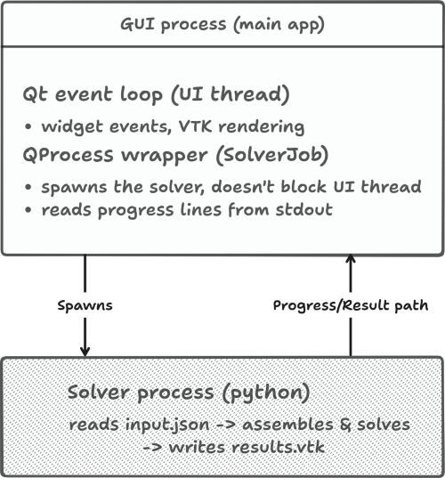
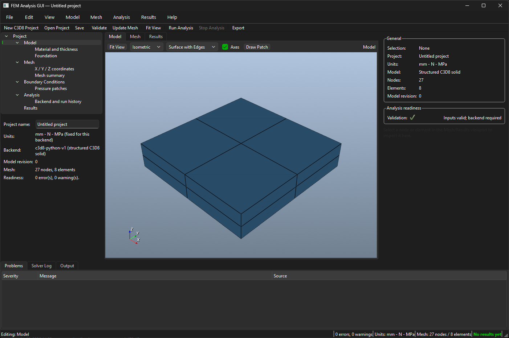

# Design Plan — GUI for a 3D FEM Analysis Program

**Submitted:** 13 September 2026\
**Technology:** C++17, Qt 6 Widgets, VTK 9 and a separate Python solver process

## 1. Architecture

The application separates its editable project data from the interface and solver process. The received C3D8 implementation reads JSON and actively exports CSV; its optional VTK writer requires geometry/order corrections. The application integration will produce validated VTK results through a process wrapper while preserving the received reference source for comparison.

| Layer | Responsibility | Components |
|---|---|---|
| Presentation | Parameter forms, navigation, mesh/result views, inspection and diagnostics | Qt Widgets, `QVTKOpenGLNativeWidget` |
| Application | New/open/save/export workflows, validation and run lifecycle | `ProjectController`, `AnalysisController` |
| Domain | Typed inputs, revisions, run snapshots, result metadata and validation issues | `ProjectDocument`, `ModelDefinition`, `RunRecord`, `ResultSet` |
| Solver | Input mapping and external process supervision | `ISolverAdapter`, backend adapters, `SolverJob`, `QProcess` |
| File services | Versioned project persistence, solver input and validated result import/export | `ProjectSerializer`, `ResultImporter`, `ResultExporter` |
| Visualization | Deterministic mesh construction and VTK presentation | Mesh builders, viewport widgets |

The C3D8 input contains these five sections:

```text
nodes:    x, y, z coordinate arrays
material: Emod, nu
subgrade: Kx, Ky, Kz
loads:    list of {q, x1, x2, y1, y2}
options:  reduced_integration
```

Project files additionally store names, patch identities and visibility, model/backend identity, revision and run history. Solver JSON contains only the numerical input sections. Existing plate projects retain their distinct model type and schema.

## 2. Design decisions

- Use C++ Qt Widgets for the native Windows interface and VTK's C++ Qt widget for rendering. Building requires a compatible MSVC toolchain and matching Qt/VTK runtimes.
- Use `QProcess` for solving so numerical execution does not occupy the GUI thread and process failures can be handled independently.
- Keep authoritative model data in `ProjectDocument`; editors submit validated changes and undoable commands.
- Select adapters by typed model identity. A schema change may also require updates to the model, editors, mesh and result profile.
- Preserve the received node order: X varies fastest, followed by Z and then Y. Build explicit eight-node hexahedral connectivity with solver IDs.
- Preserve raw coordinates. The received implementation loads z-min toward positive Z and places the foundation at z-max. Author confirmation of physical conventions and units remains required.
- Lock model-changing actions during a run. Store an immutable input snapshot and identify stale results by model revision.
- Keep full integration as the supported numerical path until reduced-integration scaling and zero-energy modes are resolved.
- Keep model, mesh and result workspaces separate, with project navigation and an inspector in resizable panels.

## 3. User workflow

```text
Create/Open Project → Edit Inputs → Inspect Mesh → Validate
                                             ↓ valid
Save/Export JSON → Run External Solver → Validate Results → Inspect/Export
                                             ↓ failure
                                     Problems and Solver Log
```

Validation errors identify the affected input. Stop requests cancellation and unlocks the model once the owned process has finished. Result acceptance requires successful process completion, valid artifacts and association with the run input.

## 4. Interface

The main window uses a horizontal splitter for project navigation, the VTK workspace and an inspector. A lower panel contains Problems, Solver Log and Output. Camera presets, display modes and axes support mesh review. Window/splitter state is persisted with `QSettings` and can be reset.

The following submitted diagrams illustrate the intended interface and process separation; they are design illustrations rather than evidence of implemented features.





## 5. Verification

Check JSON round trips and transactional load rejection, mesh order and connectivity, model revisions and undo, process failures/cancellation, result geometry/fields and native picking/rendering. Numerical tests must distinguish software regression against received source from independent physical acceptance.

Implementation progress and executed checks are recorded in the [Week 1 report](week1/WEEK1_REPORT.md) and [Week 2 report](week2/WEEK2_REPORT.md).
