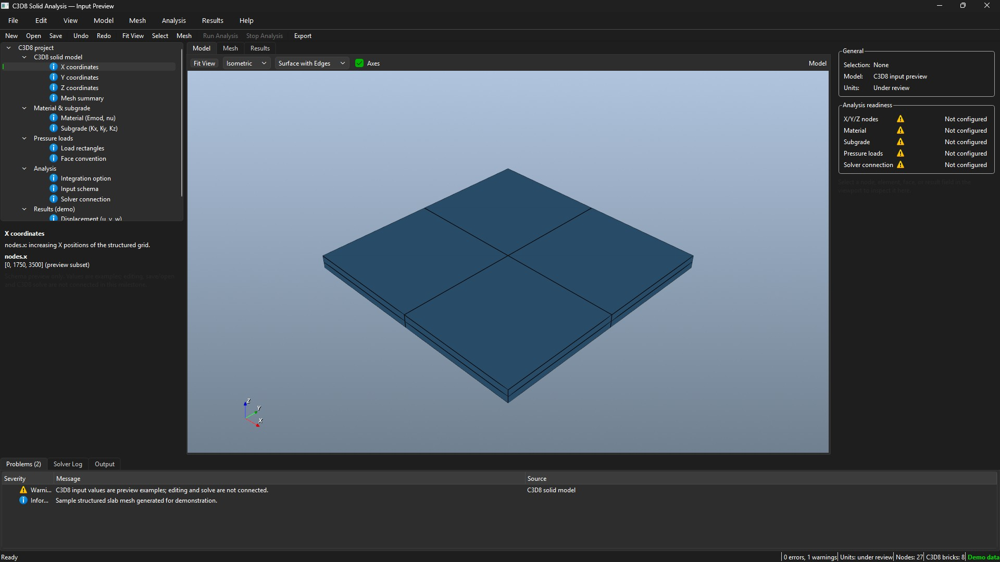
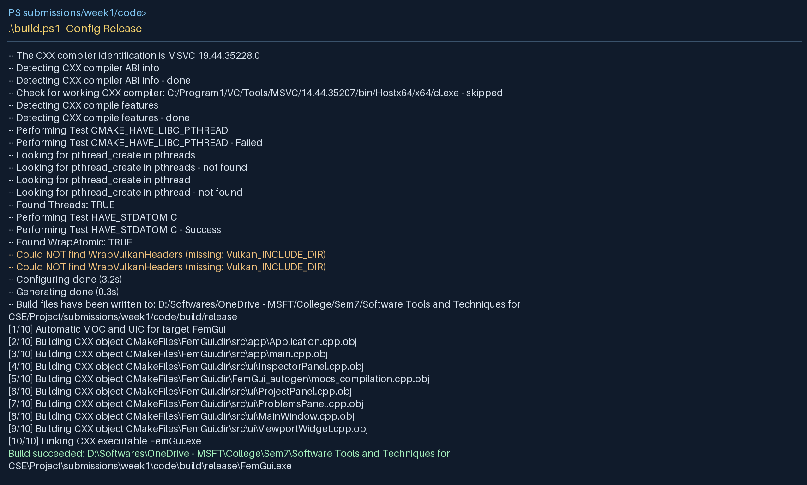
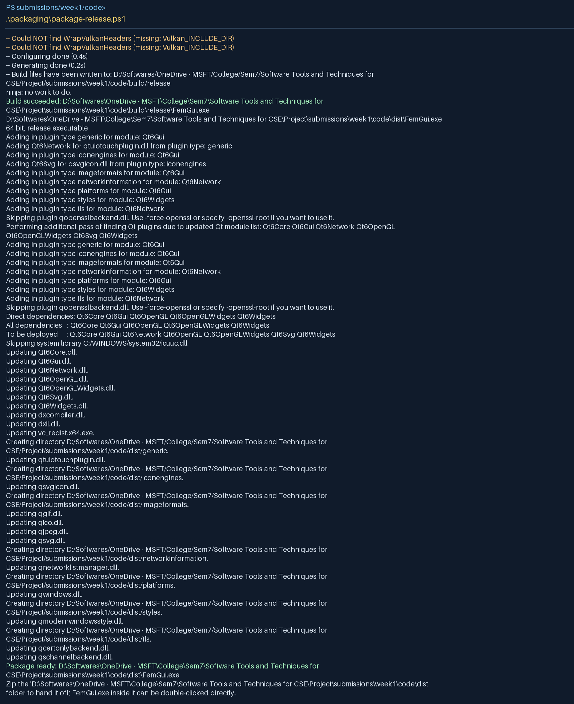

# Week 1 progress report

**Project:** FEM Analysis GUI\
**Submitted milestone:** C3D8 input-preview GUI

Week 1 establishes the desktop application structure, read-only C3D8 parameter pages and an eight-brick slab preview. The next development step is to connect those pages to an editable project model with validation and persistence.

## 1. Task status

| Status | Task | Evidence in this packet |
|---|---|---|
| Completed | Established C++17, Qt Widgets, VTK, CMake and MSVC project structure | `code/CMakeLists.txt`, `code/CMakePresets.json`, `code/build.ps1` |
| Completed | Reviewed the received C3D8 input structure: `nodes`, `material`, `subgrade`, `loads`, `options` | `code/examples/received-c3d8-input.json` |
| Completed | Replaced generic FEM navigation with C3D8 X/Y/Z, Emod/nu, Kx/Ky/Kz, pressure and integration pages showing read-only example values | `code/src/ui/ProjectPanel.*` |
| Completed | Updated main window menus, inspector and status to describe C3D8 rather than generic element/constraint options | `code/src/ui/MainWindow.cpp`, `InspectorPanel.cpp` |
| Completed | Added a small C3D8 slab preview (27 nodes, 8 bricks), plus Model/Mesh/Results demo tabs and logs | `code/src/ui/ViewportWidget.cpp` |
| In progress | Define editable C3D8 project data, validation and JSON persistence | - |
| Up Next | Connect the received C3D8 solver, import real fields, qualify numerical behavior and extend automated tests | - |

## 2. Problems and dependencies

- The Week 1 executable shows a generated **C3D8-shaped** slab preview and a Results-tab geometry placeholder; it does not perform engineering analysis.
- Parameters shown on the left are read-only schema examples copied from the received input. Edits, project persistence and solver validation are planned for later milestones.
- New/Open/Save, solver execution and several other menu actions are placeholders in this version. These are known scope gaps for the next milestones.
- The raw executable requires compatible Qt and VTK runtime DLLs. A screenshot-ready standalone package was built and passed a clean-PATH launch smoke check on this machine.
- No automated test suite is defined in the Week 1 source. The build and two launch smoke checks below give limited evidence only.

## 3. Time spent by each member in the previous week

**Reported effort:** 8 hours per member, 40 hours total, with equal contribution across the five team members. The table records the task allocation.

| Member | Task 1 | Hours | Task 2 | Hours | Shared review | Hours | Total |
|---|---|---:|---|---:|---|---:|---:|
| **Piyush Choudhary** | C3D8 input-schema review and parameter mapping | 4 | Prototype architecture and module design | 2 | Cross-review of UI and documentation | 2 | 8 |
| **Shivansh Shukla** | C3D8 navigation tree and coordinate pages | 4 | Material/subgrade preview pages | 2 | Cross-review of UI and documentation | 2 | 8 |
| **Soham Shrivastava** | Pressure/integration preview pages | 4 | Inspector and status terminology | 2 | Cross-review of UI and documentation | 2 | 8 |
| **Swain Laxmidhar** | Structured C3D8 slab preview | 4 | View controls and demo tab labels | 2 | Cross-review of UI and documentation | 2 | 8 |
| **Yash Shashikant Yeole** | Build and screenshot package | 3 | Report, logs and smoke checks | 3 | Cross-review of UI and documentation | 2 | 8 |

## 4. Meetings
### Meeting with Project Instructor
**Date/time:**   13 September 2026, 4:30 p.m to 5:30 p.m.
**PI:** Prof. Sushobhan Sen\
**Attendees:** Piyush Choudhary, Shivansh Shukla, Soham Shrivastava, Swain Laxmidhar, Yash Shashikant Yeole\
**Decisions or feedback:**  Discussed the problems that may arise while integrating the C3D8 solver with the GUI.

### Internal team meetings
#### Meeting 1
**Date/time:** 14 September 2026, 4:30 p.m to 5:30 p.m.\
**Attendees:** All team members\
**Decisions or feedback:**  Divided the tasks among the team members and discussed the plan.
#### Meeting 2
**Date/time:** 20 September 2026, 10:30 p.m to 11:30 p.m.\
**Attendees:** All team members\
**Decisions or feedback:**  Organized and put together the work done by each team member and tried the initial build of the project.

## 5. Current build

**Original build:** 25 September 2026.\
**Corrected-source verification:** 1 October 2026.\
**Build:** Release, Windows/MSVC x64, source in `code/`.\
**Result:** Successful clean Release build (**10/10** steps) for the C3D8 update; executable `FemGui.exe` produced. A standalone local package was refreshed under `code/dist/`. See `evidence/BUILD_AND_TEST.md` for commands and environment. Generated binaries are not committed.

## 6. Tests on this build

| Test scope | Total | Unsuccessful | Result |
|---|---:|---:|---|
| Automated launch smoke check: application remains running for three seconds with Qt offscreen platform | 1 | 0 | Passed on 25 September; rechecked on 1 October 2026 |
| Standalone package launch with Windows and package DLL paths only | 1 | 0 | Passed on 25 September; rechecked on 1 October 2026 |
| Manual UI and visual checks | 0 executed/recorded | 0 recorded | No separate interaction checklist recorded |

**Reported total executed:** **2**. **Unsuccessful:** **0**. This count does not include compilation as a test and does not imply numerical correctness. Week 1 has no registered CTest cases.

## 7. Defects found in QA

**Confirmed defects in the executed smoke check:** None. The smoke check verifies startup survival only. Build and UI review identified the issues listed below. The included application screenshot records the interface; a separate manual interaction QA record is not available.

| ID | Defect and reproduction | Severity | Status/owner |
|---|---|---|---|
| QA-01 | Running `code/build.ps1 -Config Release` on the team's current Windows setup failed because `vcvars64.bat` was only sought under `C:\Program`; it is installed under `C:\Program1`. Expected: locate the available supported toolchain. | Build blocker on this machine | Fixed in `code/build.ps1`; Release rebuild passed. |
| QA-02 | The initial prototype navigation still offered generic sections, modal analysis and arbitrary constraints despite the received C3D8 input accepting a structured solid, material, subgrade, pressure rectangles and an integration flag. | Misleading setup UI | Fixed in the Week 1 C3D8 preview pages and menus. |
| QA-03 | Case-variant PATH entries could overwrite MSVC toolchain paths during environment import. | Build blocker | Fixed: import each key once and explicitly select MSVC; 1 October Release build passed. |
| QA-04 | Packaging accepted an arbitrary output directory and deleted existing contents. | File-loss risk | Fixed: restrict the output location and preserve the previous package; packaging and clean-PATH check passed. |
| QA-05 | Some labels described synthetic result fields although the viewport contains only preview geometry. | Misleading UI description | Fixed in the parameter and About text; report/README now describe the Results placeholder accurately. |

The missing project I/O, solver integration and live results noted above are planned functionality gaps in this milestone, not failed tests.

## Visual evidence

### C3D8 input-preview application — original Week 1 capture

### Clean Release build

The image below renders the real clean-build transcript; the complete output is in `evidence/build-2026-10-01.log`.

### Standalone distribution

The image below renders the real packaging transcript; the complete output is in `evidence/package-2026-10-01.log`.

