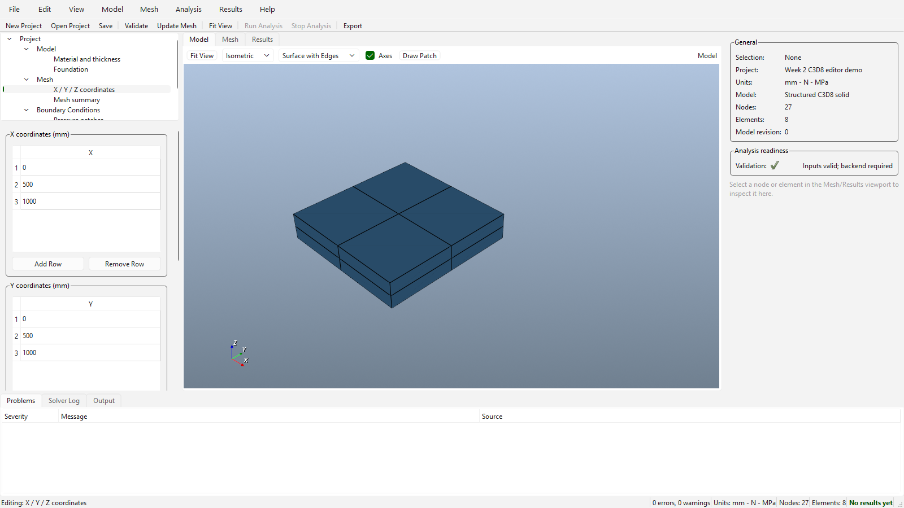
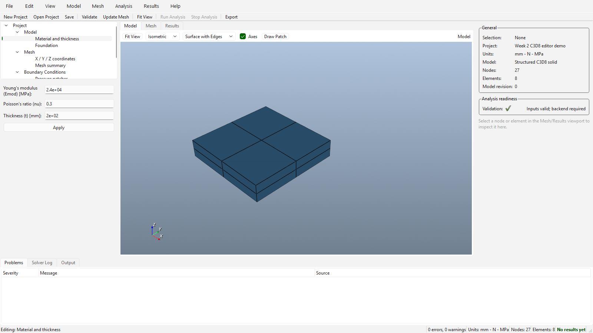
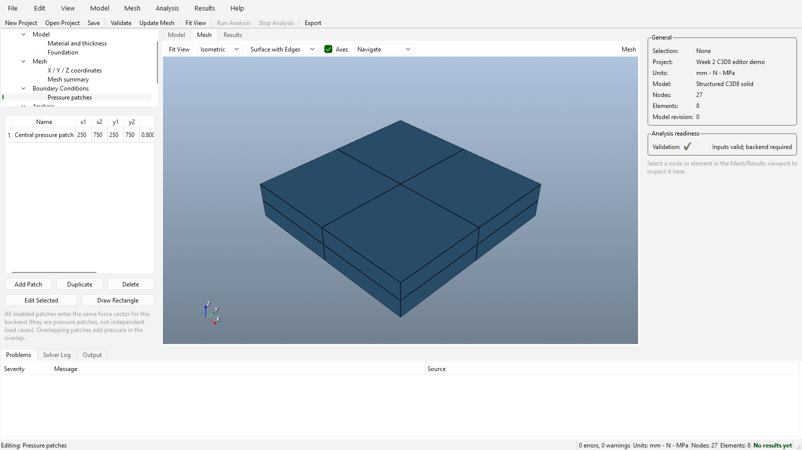

# Week 2 progress report — 1 October 2026

**Project:** FEM Analysis GUI with C3D8 solid solver\
**Submission milestone:** Editable C3D8 model, project persistence and exact brick mesh\
**Reporting window:** 26 September–1 October 2026\

Week 2 extends the read-only preview with editable project data, schema-2 persistence, exact solid meshing and model inspection. Recorded build and test results are dated **1 October 2026**.

## 1. Tasks completed, in progress and planned

| Status | Task | Evidence |
|---|---|---|
| Completed | Added a typed `structured_solid_c3d8` document and C3D8 adapter that maps the received `nodes`, `material`, `subgrade`, `loads` and `options` input sections. | `code/src/core/SolidDefinition.h`, `code/src/solver/C3D8SolverAdapter.*` |
| Completed | Added schema-2 save/open for solid projects, model/backend identity checks and plate-project migration. | `code/src/io/ProjectSerializer.*`, `code/src/controllers/ProjectController.*` |
| Completed | Bound X/Y/Z coordinate, material, foundation and pressure-patch editors to the project model. The editors validate inputs and update model revision/undo history. | `code/src/ui/ProjectPanel.*`, `code/src/ui/PressurePatchDialog.*` |
| Completed | Built C3D8 volume cells in the received source ordering, with solver node/element IDs and loaded/foundation face labels. Added solid viewport and inspector support. | `code/src/visualization/C3D8MeshBuilder.*`, `code/src/ui/ViewportWidget.*`, `code/src/ui/InspectorPanel.*` |
| Completed | Recorded an executable reference baseline for the received C3D8 source and regression fixtures. | `code/docs/C3D8_BASELINE.md`, `code/tests/fixtures/c3d8/` |
| In progress | Production C3D8 process wrapper and direct execution contract. The GUI run action remains disabled for solid projects in this version. | [Implementation status](code/docs/IMPLEMENTATION_STATUS.md) |
| Planned | Import real solid result fields, complete GUI solve lifecycle, author-confirmed conventions and independent physical comparison. | Later milestones |

## 2. Problems and dependencies

- The received reduced-integration path has incorrect stiffness scaling and rank deficiency in the recorded cases. This milestone stores the option for fidelity but rejects it for execution; only full integration is the planned supported path.
- Units, coordinate/face conventions and independent engineering tolerances still need confirmation from the solver author or an accepted external benchmark.
- The Week 2 GUI can edit and save a solid model, but **does not run C3D8 or display computed solid results**. The [example project](examples/demo-c3d8.femproject.json) has no run history.
- New sessions still start from the earlier plate model. A C3D8 project can be opened through File > Open Project, as shown in the included native captures.

## 3. Time spent by each member in the previous week

**Reported effort:** 8 hours per member, 40 hours total, with equal contribution across the five team members. The table records the task allocation.

| Member | Task 1 | Hours | Task 2 | Hours | Shared review | Hours | Total |
|---|---|---:|---|---:|---|---:|---:|
| Piyush Choudhary | Typed C3D8 model and backend boundary | 4 | Schema-2 project save/open design | 2 | Cross-review and integration | 2 | 8 |
| Shivansh Shukla | X/Y/Z coordinate editor | 4 | Material and foundation editors | 2 | Cross-review and integration | 2 | 8 |
| Soham Shrivastava | Pressure-patch workflow | 3 | Adapter validation and input mapping | 3 | Cross-review and integration | 2 | 8 |
| Swain Laxmidhar | Exact C3D8 volume mesh | 4 | Viewport and node/element inspection | 2 | Cross-review and integration | 2 | 8 |
| Yash Shashikant Yeole | Reference fixtures and regression checks | 3 | Build, QA evidence and report | 3 | Cross-review and integration | 2 | 8 |

## 4. Last meeting with the point of contact

**Last documented meeting:** 13 September 2026, 4:30–5:30 p.m. IST\
**Point of contact / project instructor:** Prof. Sushobhan Sen\
**Attendees:** Piyush Choudhary, Shivansh Shukla, Soham Shrivastava, Swain Laxmidhar and Yash Shashikant Yeole\
**Discussion:** Potential issues in integrating the received C3D8 solver with the GUI.\

## 5. Current build

**Build date:** 1 October 2026.\
**Build:** Clean Release build, Windows x64/MSVC 19.44, Qt 6.11.2 and VTK 9.7.0.\
**Result:** CMake configured; Ninja completed **31/31** steps, producing `FemGui.exe` and `FemGuiTests.exe`.\
**Executable SHA-256:** `1313FB697EE3758A0E8F8F77410CAAF99A60A907C16EF880077446CD319AB960`.\
The source packet excludes generated binaries; see [build evidence](evidence/BUILD_AND_TEST.md).

## 6. Tests on the build

| Executed check | Total | Unsuccessful | Result |
|---|---:|---:|---|
| Registered CTest suites: Integration, SolverContract, NumericalQualification, C3D8Reference | 4 | 0 | All passed on 1 October 2026 |
| Native Windows GUI capture check: opens the supplied schema-2 C3D8 example and records the editor/mesh views | 1 | 0 | Passed on 1 October 2026 |
| **Total executed checks** | **5** | **0** | **Passed** |

The CTest count is at the **suite** level. Full results are in `evidence/ctest-2026-10-01.log` and `evidence/native-visual-capture.log`.

## 7. Defects found in QA

| ID | Finding | Status at this milestone |
|---|---|---|
| W2-QA-01 | The received reduced-integration solid and foundation matrices are under-scaled in the recorded checks; the tested single brick also has rank deficiency. | Mitigated: the C3D8 adapter rejects reduced integration. A corrected mathematical implementation needs separate review. |
| W2-QA-02 | The received CLI prints an error for malformed `{}` input but exits with code zero and no output CSV. | Open for the production wrapper milestone, which must return a failure exit. |
| W2-QA-03 | Numeric forms displayed unnecessary binary floating-point digits, including the sample Poisson ratio. | Fixed: use the shortest display that round-trips to the same double; precision and unchanged-Apply regression checks pass. |
| W2-QA-04 | Pressure inspection reported surface loads on bricks that do not touch the loaded face. | Fixed: only z-min bricks report applied pressure; the deeper-brick regression passes. |
| W2-QA-05 | Reopening plate results checked geometry/fields but skipped production manifest and hash verification. | Fixed: archived input, result hashes and snapshot identity are checked; tampered-result regression passes. |
| W2-QA-06 | A C3D8 model above the preview limit could validate while its viewport was empty. | Fixed: validation reports the one-million-node preview limit. |
| W2-QA-07 | Malformed run history could be treated as an empty list. | Fixed: non-array run history is rejected transactionally. |
| W2-QA-08 | Case-variant PATH entries could replace the MSVC environment with the original path. | Fixed: import each environment key once and select MSVC explicitly in the presets; fresh Release build passed. |

The first two findings concern the unchanged received C3D8 reference source and remain recorded in `code/docs/C3D8_BASELINE.md`. Reduced integration is excluded by validation; the production-wrapper failure contract remains pending. Application fixes above are included in the passing regression run. Mesh construction and reopening large saved results still execute on the GUI thread and may delay the interface.

## Visual evidence

Additional native captures: [foundation Kx/Ky/Kz](visuals/04-foundation-editor.png) · [pressure patch table](visuals/05-pressure-patches.png).

Milestone diagram: [Week 1 → Week 2 progress](visuals/01-progress-map.svg).\
Build evidence: [clean build output](visuals/06-clean-build.png) · [CTest results](visuals/07-ctest-results.png).
