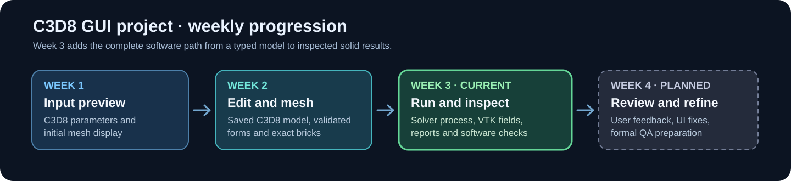
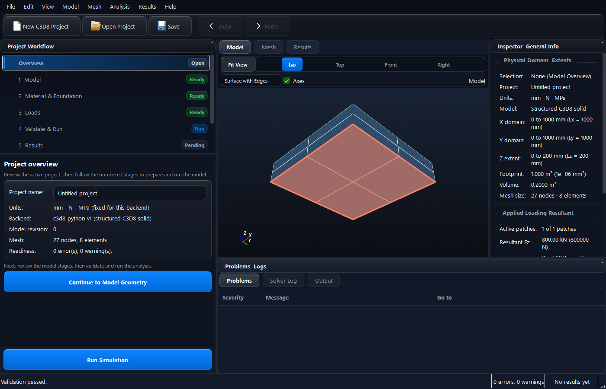
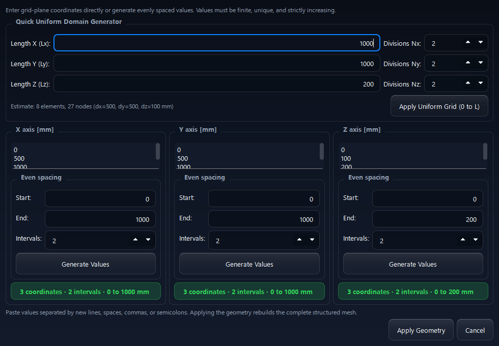
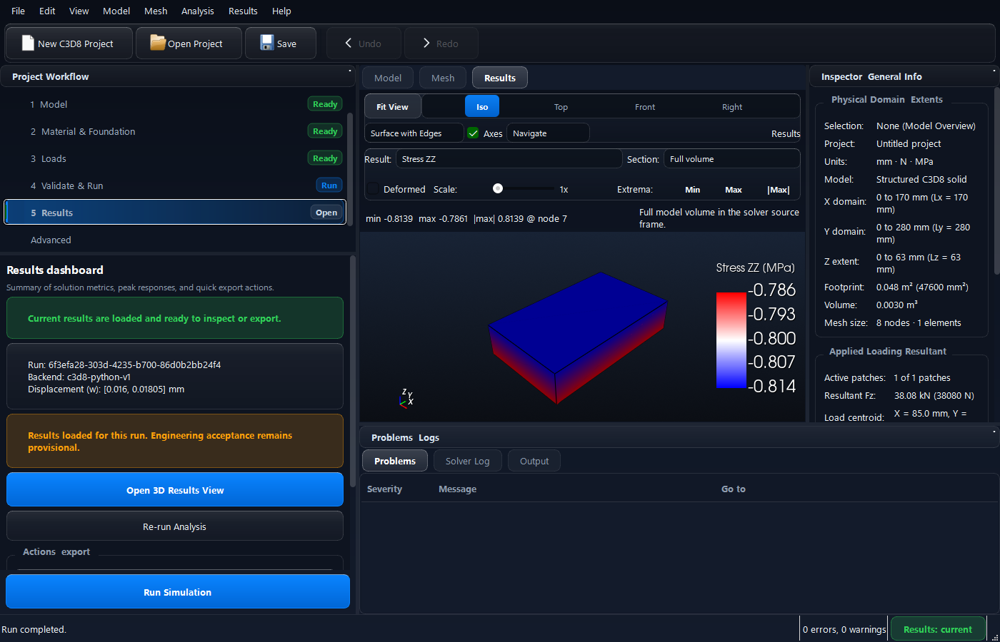

# Week 3 progress report — 8 October 2026

**Project:** FEM Analysis GUI with C3D8 solid solver\
**Submission milestone:** Edit → validate → solve → inspect and export 3D solid results\
**Reporting window:** 2–8 October 2026

Week 3 extends the editable model and mesh with production C3D8 execution, validated solid results, guided setup and reporting. Build, regression and native desktop verification of the corrected source are recorded on **8 October 2026**.

## 1. Tasks completed, in progress, and planned

| Status | Task | Evidence |
|---|---|---|
| Completed | Added a production C3D8 command-line wrapper with strict input checks, structured progress, cancellation, distinct failure exits, and atomic VTK/manifest publication. | `code/solver/c3d8/`, `code/docs/C3D8_C4_PRODUCTION_WRAPPER.md`, [sample output](examples/README.md) |
| Completed | Imported and checked hexahedral results, exposed 16 selectable scalar entries, alongside the displacement vector, and added sections, deformation, extrema, selection, and CSV/PNG export. | `code/src/io/ResultImporter.*`, `code/src/ui/ViewportWidget.*`, `code/docs/C3D8_C5_RESULTS.md`, `code/docs/C3D8_C7_INTERACTION_REPORTS.md` |
| Completed | Connected the GUI to the real C3D8 solve lifecycle: backend discovery, project validation, immutable input snapshot, process launch, completion verification, result ownership, save/reopen, and stale-result handling. | `code/src/controllers/AnalysisController.*`, `code/src/controllers/ProjectController.*`, `code/docs/C3D8_C6_GUI_SOLVE.md` |
| Completed | Added a guided C3D8 workflow, dedicated geometry editor, material/foundation and load editing, mesh/model views, and a results dashboard. | [workflow](visuals/01-guided-workflow.png), [geometry editor](visuals/02-geometry-editor.png), [real result view](visuals/04-c3d8-results-window.png) |
| Completed | Implemented numerical software-health gates, recorded reference/production cases, and supplied release packaging scripts with a shared frozen solver design. | `code/docs/C3D8_C8_QUALIFICATION.md`, `code/docs/C3D8_C9_PACKAGE.md`, `code/docs/C3D8_C11_PACKAGE_OPTIMIZATION.md`, [test evidence](evidence/BUILD_AND_TEST.md) |
| In progress | Collect user feedback, review remaining Qt diagnostics, and complete deployment checks on the current UI build. | [QA findings](#7-defects-found-in-qa) |
| Planned for Week 4 and test phases | Formal user scenarios, independent physical comparison and convention sign-off, full package handoff, and Phase 1/Phase 2 QA evidence. | `code/docs/C3D8_C8_QUALIFICATION.md` |

## 2. Problems and dependencies

- **Physical acceptance remains open.** The C3D8 software checks and analytical compression example pass, but source-Z direction, units/foundation convention, an accepted independent nonuniform benchmark, and engineering tolerances still require author or PoC confirmation. The solver is therefore described as provisional.
- The received **reduced-integration path remains unsupported** because its intake checks found scale/rank problems. The supported production path uses full integration.
- The result controls and legend have been adjusted for the recorded 1400 × 900 desktop view. Broader screen-size and user-feedback checks remain part of subsequent QA.
- The Week 3 packet contains source and evidence, plus a small solved VTK example. A current-UI frozen distribution is reserved for later packaging verification; an older development `dist` is not presented as this week's build.

## 3. Time spent by each member in the previous week

**Reported effort:** 40 person-hours, 8 per member, with equal contribution across the five team members. The table records the task allocation.

| Member | Task 1 | Hours | Task 2 | Hours | Shared review | Hours | Total |
|---|---|---:|---|---:|---|---:|---:|
| Piyush Choudhary | C3D8 process and completion contract | 3 | Provenance and run-state handling | 3 | Cross-review and integration | 2 | 8 |
| Shivansh Shukla | Solid result import and field catalog | 3 | Sections, deformation, and result inspection | 3 | Cross-review and integration | 2 | 8 |
| Soham Shrivastava | GUI run workflow and validation | 3 | Save/reopen and stale-result behavior | 3 | Cross-review and integration | 2 | 8 |
| Swain Laxmidhar | Guided geometry/load interaction | 3 | Viewport selection and result exports | 3 | Cross-review and integration | 2 | 8 |
| Yash Shashikant Yeole | Numerical and regression qualification | 3 | Build, package procedure, QA evidence | 3 | Cross-review and integration | 2 | 8 |

**Total reported effort:** 40 person-hours, 8 per member.

## 4. Last meeting with the point of contact

**Last documented meeting:** 13 September 2026, 4:30–5:30 p.m. IST\
**PoC / instructor:** Prof. Sushobhan Sen\
**Documented discussion:** integration issues with the received C3D8 solver.\
No later PoC meeting is recorded in the project meeting log.

## 5. Current build

**Build date:** 8 October 2026.\
**Environment:** Windows 11 x64, MSVC 19.44.35228, Qt 6.11.2, VTK 9.7.0, CMake 4.0.2, Python 3.12.2.\
**Result:** CMake configured; a fresh Release build completed **33/33** steps, followed by a successful legend-spacing rebuild and produced `FemGui.exe` and `FemGuiTests.exe`.\
**Application SHA-256:** `3896C73265C05B5386C0B20651B076F20E6CB1D659DE7ADF88E6926B28C8C924`.

The exact logs and environment note are in the [build/test evidence guide](evidence/BUILD_AND_TEST.md). Generated binaries are excluded from the source packet.

## 6. Results of tests on the build

| Executed check group | Total | Unsuccessful | Result |
|---|---:|---:|---|
| Registered CTest suites: Integration, SolverContract, NumericalQualification, C3D8Reference, C3D8Production, C3D8Qualification | 6 | 0 | All passed on 8 October |
| Native Windows GUI run covering four named QtTest methods, including a real C3D8 solve/results capture | 1 | 0 | Passed; 4/4 named methods |
| **Total executed groups** | **7** | **0** | **Passed** |

CTest is counted at the **suite** level and the native desktop invocation is counted as one group, consistent with the prior weekly report. The 8 October standalone one-brick CLI run completed and produced `results.vtk` plus `run-result.json`; it is demonstration output and is not added to the test count. The manifest records **8 nodes, 1 element, 24 DOFs**, a maximum absolute displacement of **0.01805 mm**, and passing numerical software thresholds. The [input and output files](examples/README.md) and [run log](evidence/single-brick-run-2026-10-08.log) are included.

## 7. Defects found in QA

| ID | Finding | Status / next action |
|---|---|---|
| W3-QA-01 | Result controls were compressed at 1400 × 900. | Corrected: camera/display and result/deformation controls use separate rows; native layout verification is recorded below. |
| W3-QA-02 | The legend title and upper tick were crowded. | Corrected: shorten the legend title and separate it from run metadata; constrain its placement and text sizing. |
| W3-QA-03 | Native checks reported an unnamed-toolbar warning and a font point-size warning. | Toolbar identity corrected; one non-failing font point-size warning remains in the current native log. |
| W3-QA-04 | Reopened results skipped manifest and hash checks. | Corrected: fresh and reopened production results share validation; result/input/manifest tampering and snapshot mismatch are regression-tested for both backends. |
| W3-QA-05 | Deeper solid bricks reported surface pressure. | Corrected: only bricks touching z-min report an applied pressure resultant. |
| W3-QA-06 | Non-array run history could be silently discarded. | Corrected: malformed history is rejected transactionally. |
| W3-QA-07 | The dashboard claimed convergence verification merely because results existed. | Corrected: the dashboard describes loaded results and provisional engineering acceptance. |
| W2-QA-01 carryover | Received reduced integration has scale/rank defects. | Mitigated by rejecting reduced integration; full integration is supported. |
| W2-QA-02 carryover | The original received CLI could report malformed input with exit zero. | Addressed in the production wrapper; covered by C3D8Production. |
| W2-QA-03 carryover | Numeric fields displayed excessive digits. | Numeric forms retain the exact unedited value and parse edited text explicitly; unchanged-Apply precision checks are retained. |

## Visual evidence

Additional native captures: [rotated pressure patch](visuals/03-load-patch-rotated.png) · [solid result viewport](visuals/05-c3d8-result-field.png) · [plate result regression](visuals/06-plate-results-regression.png). Recorded-output visuals: [clean build](visuals/07-clean-build.png) · [CTest](visuals/08-ctest-results.png) · [native GUI checks](visuals/09-native-gui-checks.png). The recorded-output PNGs are rendered from exact text logs; the application PNGs are native screenshots.
